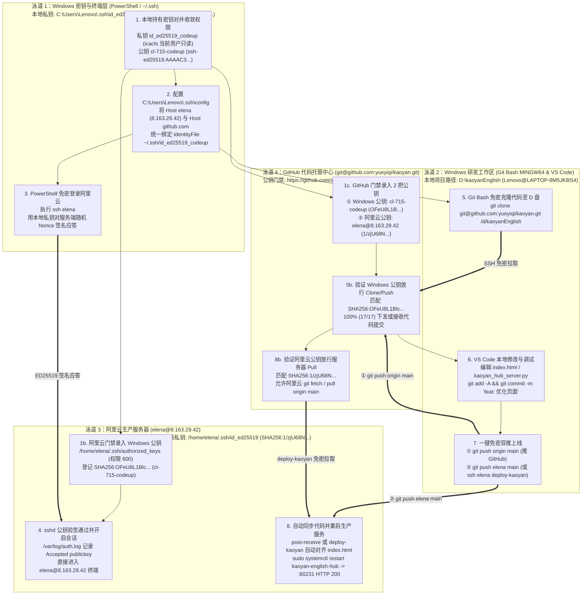
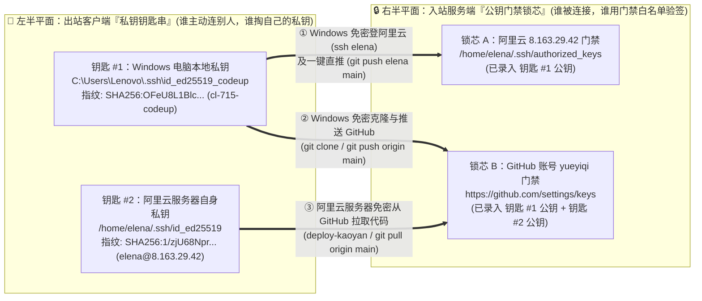
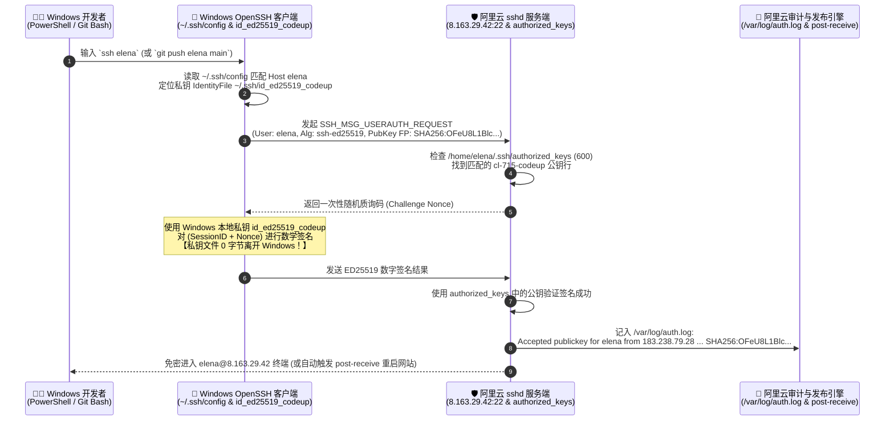

# Windows 视角 SSH 免密登录与 Git 发布框架：UML 互动泳道图及五大可视化大典
# (Windows-Centric SSH Passwordless Auth & VS Code Git Auto-Deploy: UML Swimlane & 5 Visual Paradigms Bible)

```yaml
[IoC_Skill_Telemetry]
Node_ID: srbg10
Agent: antigravity
LLM_Model: gemini-4-argon-high
Task_EB: eb_9036_srbg10_H_antigravity_gemini-4-argon-high_kaoyan-english-web-semantic-spec-and-prd-shunt
Status: VERIFIED
Evidence_IDs:
  - ev:ev-0025
  - ev:ev-0026
  - ev:ev-0027
  - ev:ev-0028
  - ev:ev-0029
  - ev:ev-0030
  - ev:ev-0032
Skills_Mounted:
  - adaptive-presentation-compiler (Skill 210)
  - completion-evidence-protocol (Skill 195)
  - anti-half-baked-reasoning
```

---

## 一、 核心解答：从纯 Windows 开发者视角，除了 UML 泳道图，还有哪些更合适的可视化方式？

> [!IMPORTANT]
> **纯 Windows 视角建模原则**：
> 剥离后台运维节点后，从 **Windows 开发者 (`Lenovo@LAPTOP-8M5JKBS4`)** 的视角来看，整个免密研发与上线世界只有 **3 个物理实体**：
> 1. **你的 Windows 电脑**（包含 `PowerShell / ~/.ssh` 密钥端 与 `Git Bash / VS Code D:\kaoyanEnglish` 研发端）
> 2. **阿里云生产服务器**（`elena@8.163.29.42`，运行 `/home/elena/kaoyan_english_hub`）
> 3. **GitHub 代码托管仓库**（`git@github.com:yueyiqi/kaoyan.git`）
>
> **UML 互动泳道图 (Swimlane Diagram)** 最适合展示**「你在 Windows 上敲什么命令 $
ightarrow$ 阿里云和 GitHub 发生什么响应」**的操作流；而针对**「为什么有 2 把不同钥匙」**、**「底层如何免密握手」**、**「报 `Permission denied` 怎么排查」**，配合以下 **5 种可视化方式**效果最佳：

| 序号 | 可视化方式 (Visualization Paradigm) | 解决的核心问题（Windows 开发者视角） | 为什么在该维度比纯泳道图更直观？ |
| :--- | :--- | :--- | :--- |
| **1** | **UML 四泳道互动流程图**<br>*(Windows-Centric Activity Swimlane)* | **「我从配好免密、拉代码到 VS Code 改完上线，每一步在哪个窗口敲什么？」** | 将 Windows 拆为 `PowerShell/SSH配置` 与 `Git Bash/VS Code` 两条泳道，配合 `阿里云 elena` 与 `GitHub` 泳道，全流程一目了然 |
| **2** | **『2 把私钥钥匙 vs 2 道公钥锁芯』二分拓扑图**<br>*(2-Key vs. 2-Lock Bipartite Graph)* | **「为什么我 Windows 能连 GitHub，刚进阿里云服务器时却连不上 GitHub？」** | 左列画 **2 把出站私钥**（Windows 的 `id_ed25519_codeup` vs 阿里云的 `id_ed25519`），右列画 **2 道入站门禁锁芯**（阿里云 `authorized_keys` vs GitHub `settings/keys`），1 秒破除方向混淆 |
| **3** | **UML 密码学挑战-应答握手时序图**<br>*(ED25519 Challenge-Response Sequence)* | **「免密登录时，我的私钥文件有没有发给服务器？为什么安全？」** | 按时间轴展示 `声明公钥指纹 -> 阿里云下发随机 Nonce -> Windows 本地私钥签名 -> 阿里云公钥验签记入 auth.log`，直观证明**私钥 0 字节离开 Windows** |
| **4** | **`Permission denied` 4 步排障决策树**<br>*(Troubleshooting State Decision Tree)* | **「当 Git Bash 或 PowerShell 报 `Permission denied (publickey)` 时先查哪？」** | 把实战 4 大坑点（① 私钥文件名带 `_codeup` 后缀未配 `config`、② Windows 私钥文件权限过宽、③ 公钥漏首字母 `s`、④ 服务器缺自身 GitHub 公钥）变成傻瓜式排查树 |
| **5** | **三模态交互式 HTML 沙盒 + 原生可编辑 PPTX**<br>*(Interactive HTML Workbench & Native PPTX)* | **「如何边点边看每一步对应的真实命令与服务器日志，或直接放进汇报 PPT？」** | 点击任意泳道步骤即可查看对应命令与 `/var/log/auth.log` 原文，支持亮底/暗夜/护眼三模态切换与 PowerPoint 原生编辑 |

---

## 二、 落盘交付物全集索引 (Persisted Deliverables)

1. **Markdown 全景大典（本文件）**：[12_sshPasswordlessUmlSwimlane_免密框架UML泳道图.md](file:///Users/liuzengyu/treeworker/workers/srbg10/.bz/08_research_frontier_前沿研究与探索验证/95_kaoyanEnglishHub_考研英语精读平台/12_sshPasswordlessUmlSwimlane_免密框架UML泳道图.md)
2. **纯 Windows 视角 UML 泳道图 ×『2钥 vs 2锁』二分拓扑高清图 (`.png` / `.svg`)**：[12_ssh_passwordless_uml_swimlane_and_key_lock_diagram_泳道与锁钥拓扑图.png](file:///Users/liuzengyu/treeworker/workers/srbg10/.bz/08_research_frontier_前沿研究与探索验证/95_kaoyanEnglishHub_考研英语精读平台/12_ssh_passwordless_uml_swimlane_and_key_lock_diagram_泳道与锁钥拓扑图.png) / [12_ssh_passwordless_uml_swimlane_and_key_lock_diagram_泳道与锁钥拓扑图.svg](file:///Users/liuzengyu/treeworker/workers/srbg10/.bz/08_research_frontier_前沿研究与探索验证/95_kaoyanEnglishHub_考研英语精读平台/12_ssh_passwordless_uml_swimlane_and_key_lock_diagram_泳道与锁钥拓扑图.svg)
3. **2x2 Bento 四象限执行摘要图 (`.png` / `.svg`)**：[12_sshPasswordlessUmlSwimlane_免密框架UML泳道图.png](file:///Users/liuzengyu/treeworker/workers/srbg10/.bz/08_research_frontier_前沿研究与探索验证/95_kaoyanEnglishHub_考研英语精读平台/12_sshPasswordlessUmlSwimlane_免密框架UML泳道图.png) / [12_sshPasswordlessUmlSwimlane_免密框架UML泳道图.svg](file:///Users/liuzengyu/treeworker/workers/srbg10/.bz/08_research_frontier_前沿研究与探索验证/95_kaoyanEnglishHub_考研英语精读平台/12_sshPasswordlessUmlSwimlane_免密框架UML泳道图.svg)
4. **交互式三模态 HTML 沙盒（5 大可切换视图）**：[12_sshPasswordlessUmlSwimlane_免密框架UML泳道图.html](file:///Users/liuzengyu/treeworker/workers/srbg10/.bz/08_research_frontier_前沿研究与探索验证/95_kaoyanEnglishHub_考研英语精读平台/12_sshPasswordlessUmlSwimlane_免密框架UML泳道图.html)
5. **100% 原生可编辑 MSU PPTX 演示文稿（6 页）**：`/Users/liuzengyu/treeworker/workers/srbg10/.bz/08_research_frontier_前沿研究与探索验证/95_kaoyanEnglishHub_考研英语精读平台/12_sshPasswordlessUmlSwimlane_免密框架UML泳道图.pptx`（幻灯片网格预览：[12_sshPasswordlessUmlSwimlane_免密框架UML泳道图_slides_preview.png](file:///Users/liuzengyu/treeworker/workers/srbg10/.bz/08_research_frontier_前沿研究与探索验证/95_kaoyanEnglishHub_考研英语精读平台/12_sshPasswordlessUmlSwimlane_免密框架UML泳道图_slides_preview.png)）

---

## 三、 视图一：纯 Windows 视角四泳道免密登录与上线互动流程图 (UML Swimlane Diagram)



---

## 四、 视图二：比泳道图更直观破除方向误区的『2 把钥匙 vs 2 道门禁』二分拓扑图 (Bipartite Graph)



---

## 五、 视图三：Windows 执行 `ssh elena` 时的 ED25519 挑战-应答握手时序图 (Sequence Diagram)



---

## 六、 视图四：Windows 视角 `Permission denied (publickey)` 4 步排障决策树 (Decision Tree)

```mermaid
flowchart TD
    Err(["🚨 报错: Permission denied (publickey)"]) --> Step1{"第 1 步：这行报错是在哪个窗口敲命令出现的？"}

    Step1 -->|"在 Windows 本地窗口敲的<br/>(PowerShell 或 MINGW64 Git Bash)"| Step2{"第 2 步：你的私钥文件名是不是非默认的 id_ed25519_codeup？"}
    Step1 -->|"在 ssh elena 登进阿里云之后<br/>在服务器里面敲 git clone/pull 出现的"| Step_ECS{"第 2b 步：GitHub settings/keys 里是否录入了<br/>阿里云服务器自己的公钥 elena@8.163.29.42？"}

    Step2 -->|"是 id_ed25519_codeup，且没配进 ~/.ssh/config"| Sol_Config["✅ 修复 A：在 C:\Users\Lenovo\.ssh\config 中<br/>为 Host elena 和 Host github.com<br/>显式指定 IdentityFile ~/.ssh/id_ed25519_codeup"]
    Step2 -->|"已配好 ~/.ssh/config"| Step3{"第 3 步：Windows 是否提示 UNPROTECTED PRIVATE KEY FILE？"}

    Step3 -->|"是 (私钥权限过宽)"| Sol_Perm["✅ 修复 B：在 PowerShell 运行 icacls 收敛权限：<br/>icacls ~/.ssh/id_ed25519_codeup /inheritance:r<br/>icacls ~/.ssh/id_ed25519_codeup /grant:r "$($env:USERNAME):(R)""]
    Step3 -->|"否 (本地权限正常)"| Sol_Auth["✅ 修复 C：检查阿里云 authorized_keys 公钥首字母<br/>确保是完整 ssh-ed25519 开头 (勿漏首字母 s)<br/>且 /home/elena/.ssh 为 700、authorized_keys 为 600"]

    Step_ECS -->|"已补录 SHA256:1/zjU68N... (ev:ev-0028)"| Sol_ECS["✅ 已彻底打通：<br/>阿里云 elena@8.163.29.42 现已可直接免密 git pull GitHub！"]
```

---

## 七、 Windows 视角全链路密钥与门禁对账表 (Pure Windows-Centric Ledger)

| 钥匙编号 | 钥匙持有人 (Client) | 私钥存放路径 (永不外传) | 公钥注释 (`Comment`) | `ssh-keygen -lf` 实测 SHA256 指纹 | 锁芯 A：阿里云 `8.163.29.42` | 锁芯 B：GitHub `yueyiqi` |
| :--- | :--- | :--- | :--- | :--- | :--- | :--- |
| **钥匙 #1** | **Windows 研发电脑 (`Lenovo`)** | `C:\Users\Lenovo\.ssh\id_ed25519_codeup` | `cl-715-codeup` | `SHA256:OFeU8L1Blc+ECOmWayawRMLIYace0UuxIVM+ojmTNiw` | ✅ 已授权 (`ssh elena` 免密) | ✅ 已授权 (`git clone/push` 免密) |
| **钥匙 #2** | **阿里云服务器 (`elena@8.163.29.42`)** | `/home/elena/.ssh/id_ed25519` | `elena@8.163.29.42` | `SHA256:1/zjU68Npra3hsJq6zhX8EDdEKVxnsHgJ4NWzDqmeI8` | *(服务器本机)* | ✅ 已授权 (`git pull` 免密) |
