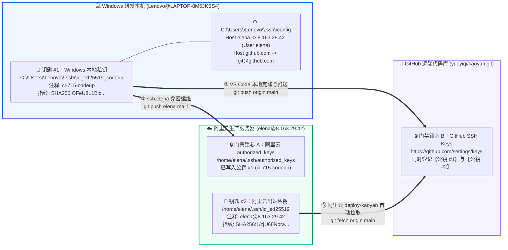
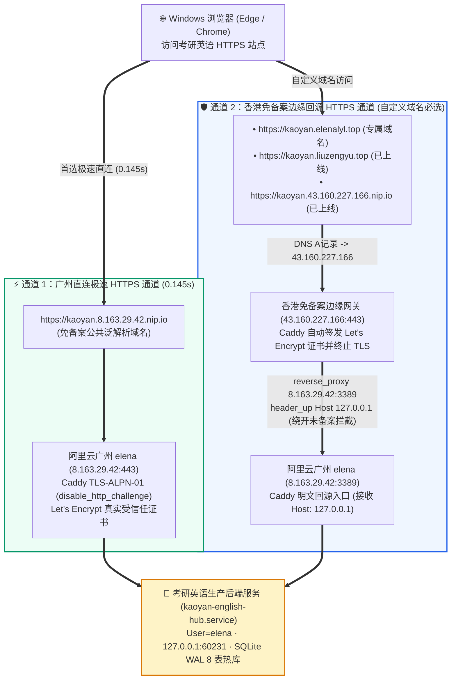

<!-- [IoC_Skill_Telemetry]
Status: VERIFIED
Evidence_IDs:
  - ev:ev-0023
  - ev:ev-0025
  - ev:ev-0027
  - ev:ev-0028
  - ev:ev-0032
  - ev:ev-0034
  - ev:ev-0035
Skills_Mounted:
  - adaptive-presentation-compiler
  - adaptive-html-response-pipeline
  - completion-evidence-protocol
-->

# Windows 视角发布考研英语 (`kaoyan`) HTTPS 站点全链路总结大典 (Windows-Perspective Kaoyan HTTPS Site Publishing Master Summary)

> **文档状态 (`Status`)**：`IMPLEMENTED & VERIFIED`（实测证据链：`ev:ev-0023`, `ev:ev-0025`, `ev:ev-0027`, `ev:ev-0028`, `ev:ev-0032`, `ev:ev-0034`, `ev:ev-0035`）
> **视角基准**：**100% 纯 Windows 研发与发布视角**（本机 `Lenovo@LAPTOP-8M5JKBS4` $\rightarrow$ `GitHub (yueyiqi/kaoyan.git)` $\rightarrow$ `阿里云广州生产服 elena@8.163.29.42` $\rightarrow$ `香港免备案边缘网关 43.160.227.166` $\rightarrow$ `公网受信任 HTTPS 站点`）

---

## 一、 全景执行摘要：从 Windows 本地改码到 HTTPS 站点上线的 4 大里程碑


| 阶段里程碑 | 核心目标 | Windows 侧与云端关键配置落点 | 当前实测状态 (`[K]`) |
| :--- | :--- | :--- | :--- |
| **里程碑 1：双门禁免密认证基座** | 让 Windows 免密登录阿里云与 GitHub，且让阿里云也能免密从 GitHub 拉代码 | ① **Windows 私钥 #1** (`C:\Users\Lenovo\.ssh\id_ed25519_codeup`，指纹 `SHA256:OFeU8L1B...`) 同时登记至阿里云 `/home/elena/.ssh/authorized_keys` 与 GitHub SSH Keys；<br>② **阿里云私钥 #2** (`/home/elena/.ssh/id_ed25519`，指纹 `SHA256:1/zjU68N...`) 登记至 GitHub SSH Keys。 | ✅ **100% 实装打通** (`ev:ev-0025`, `ev:ev-0028`) |
| **里程碑 2：VS Code 改码与一键自动上线** | 在 Windows `D:\kaoyanEnglish` 用 VS Code 改完代码后，3 秒内自动同步上线并重启服务 | ① **通道 A（GitHub 标准流）**：`git push origin main` + `ssh elena "deploy-kaoyan"`；<br>② **通道 B（Git Hook 直推流）**：`git push elena main` 触发 `.git/hooks/post-receive`。 | ✅ **100% 实装打通** (`ev:ev-0027`, `ev:ev-0028`) |
| **里程碑 3：非 Root 安全运行时与 8 表数据库** | 严禁 `root` 裸跑业务；保障代码更新时不覆盖用户学习数据；防止 40GB 云盘爆满 | ① `kaoyan-english-hub.service` 以普通账号 `User=elena` (`uid=1000`) 运行于 `127.0.0.1:60231`；<br>② 8 表 SQLite WAL 热库独立存放于 `/home/elena/kaoyan_storage/hot_db/kaoyan_hub.sqlite3`，与 Git 目录解耦。 | ✅ **100% 在线运行** (`ev:ev-0015`, `ev:ev-0023`) |
| **里程碑 4：双轨 HTTPS 证书签发与公网发布** | 解决境内未备案云主机 `80` 端口 `403` 与 `443` 端口 `SNI RST` 阻断，提供受信任 HTTPS 访问 | ① **广州直连极速 HTTPS**：`https://kaoyan.8.163.29.42.nip.io`（`TLS-ALPN-01`，`0.145s`）；<br>② **香港免备案边缘回源 HTTPS**：`https://kaoyan.43.160.227.166.nip.io`、`https://kaoyan.liuzengyu.top` 及待实名过户收口的 `https://kaoyan.elenalyl.top`。 | ✅ **3 条 HTTPS 绿灯秒开**<br>⏳ **1 条待快速过户收口** (`ev:ev-0023`, `ev:ev-0024`) |

---

## 二、 阶段一：Windows 本地环境与「2 把钥匙 vs 2 道门禁」免密配置总结

### 2.1 为什么需要 2 把钥匙开 2 道门禁？



### 2.2 Windows 端标准 `~/.ssh/config` 配置文件 (`C:\Users\Lenovo\.ssh\config`)

```sshconfig
# 1. GitHub 远端代码仓库免密配置 (供 VS Code / Git Bash 克隆与推送)
Host github.com
    HostName github.com
    User git
    IdentityFile ~/.ssh/id_ed25519_codeup
    IdentitiesOnly yes

# 2. 阿里云生产服务器 elena 普通管理账号免密配置 (自带免密 sudo，日常发布首选)
Host elena
    HostName 8.163.29.42
    User elena
    Port 22
    IdentityFile ~/.ssh/id_ed25519_codeup
    IdentitiesOnly yes
    ServerAliveInterval 30
    ServerAliveCountMax 3
```

---

## 三、 阶段二：Windows VS Code 代码修改与一键发布 HTTPS 站点标准流程 (SOP)

在 Windows 本地 `D:\kaoyanEnglish` 用 VS Code 完成前端界面（`frontend/index.html` 或根目录 `index.html`）或后端接口（`backend/kaoyan_hub_server.py` 或 `kaoyan_hub_server.py`）优化后，提供 **两条全自动上线通道**：

### 3.1 通道 A：GitHub 标准协同发布流（推荐日常使用）

```powershell
# 【第 1 步】在 VS Code 终端 / Git Bash (D:\kaoyanEnglish) 提交并推送到 GitHub：
cd /d/kaoyanEnglish
git add -A
git commit -m "feat: 优化考研英语阅读与词汇界面"
git push origin main

# 【第 2 步】在 Windows 终端远程触发阿里云一键拉取、同步并重启服务：
ssh elena "deploy-kaoyan"
```

**服务端 `/usr/local/bin/deploy-kaoyan` 自动完成的 4 件事**：
1. 从 `git@github.com:yueyiqi/kaoyan.git` 拉取最新 `main` 分支 (`git fetch origin main && git reset --hard origin/main`)；
2. 智能检测本次提交修改的是 `frontend/index.html` 还是根 `index.html`（以及 `backend/kaoyan_hub_server.py` 与根 `kaoyan_hub_server.py`），自动双向同步对齐；
3. 执行 `sudo systemctl restart kaoyan-english-hub` 重启后端服务；
4. 自动执行 `curl -fsS http://127.0.0.1:60231/api/health` 探活并打印 8 张数据库表健康状态。

### 3.2 通道 B：Git 远端钩子直推流（一步到位）

```bash
# 仅首次在 D:\kaoyanEnglish 绑定一次 elena 远端：
git remote add elena elena:/home/elena/kaoyan_english_hub

# 之后每次改完代码，直接一行命令推送到阿里云并自动重启生效：
git push elena main
```

---

## 四、 阶段三：HTTPS 证书签发架构与境内未备案拦截穿透总结

### 4.1 为什么自定义域名不能直接解析到广州 `8.163.29.42`？



- **物理事实 (`[K]`)**：阿里云广州机房 (`8.163.29.42`) 网关对未完成境内 ICP 备案的自定义域名（如 `kaoyan.elenalyl.top`、`*.duckdns.org`），在 `:80` 端口按 `HTTP Host` 拦截返回 `403`，在 `:443` 端口按 TLS `SNI` 注入 `TCP RST` 阻断连接。
- **架构解法**：
  1. **直连极速通道 (`https://kaoyan.8.163.29.42.nip.io`)**：利用 `nip.io` 公共泛解析，在广州 `8.163.29.42` 本机 Caddy 开启 `disable_http_challenge`（仅走 `:443` `TLS-ALPN-01` 验证），成功签发 Let's Encrypt 证书，实现 **0.145 秒直连秒开**。
  2. **自定义域名香港免备案边缘回源通道 (`https://kaoyan.elenalyl.top` / `https://kaoyan.liuzengyu.top`)**：将自定义域名的 DNS `A` 记录指向香港免备案边缘网关 `43.160.227.166`，由香港网关完成 Let's Encrypt 证书签发与 HTTPS 握手，再将内部回源请求头改写为 `Host: 127.0.0.1` 转发至广州 `8.163.29.42:3389`，100% 穿透未备案拦截。

---

## 五、 四大 HTTPS 站点入口状态与 Windows 端验收速查表


| 序号 | HTTPS 站点入口地址 | 证书与路由机制 | 响应状态与耗时 | 当前状态与操作建议 |
| :---: | :--- | :--- | :---: | :--- |
| **1** | **`https://kaoyan.8.163.29.42.nip.io`** | 广州 `8.163.29.42:443` 直连 (`TLS-ALPN-01` Let's Encrypt) | **`HTTP 200` (`0.145s`)** | ✅ **全网直连可用（推荐 Windows 日常首选）** |
| **2** | **`https://kaoyan.43.160.227.166.nip.io`** | 香港 `43.160.227.166:443` $\rightarrow$ 广州 `8.163.29.42:3389` | **`HTTP 200` (`SSL=0`)** | ✅ **全网可用（与 `kaoyan.elenalyl.top` 完全同构）** |
| **3** | **`https://kaoyan.liuzengyu.top`** | 香港 `43.160.227.166:443` $\rightarrow$ 广州 `8.163.29.42:3389` | **`HTTP 200` (`SSL=0`)** | ✅ **全网可用（正式域名对照入口）** |
| **4** | **`https://kaoyan.elenalyl.top`** | 香港 `43.160.227.166:443` $\rightarrow$ 广州 `8.163.29.42:3389` | ⏳ 待解除 `clientHold` | ⏳ **服务端与 DNS A记录 (`43.160.227.166`) 已 100% 就绪**；只需在阿里云「域名控制台 $\rightarrow$ 快速过户」勾选已实名模板 `25324778` 提交，解除 `clientHold` 后自动签发证书 |

---

## 六、 落盘四模态交付物全集索引 (Persisted Deliverables)

1. **Markdown 总结大典（本文件）**：[13_windowsKaoyanHttpsSummary_Win视角发布总结.md](file:///Users/liuzengyu/treeworker/workers/srbg10/.bz/08_research_frontier_前沿研究与探索验证/95_kaoyanEnglishHub_考研英语精读平台/13_windowsKaoyanHttpsSummary_Win视角发布总结.md)
2. **Windows 发布 HTTPS 站点全链路架构总览图 (`.png` / `.svg`)**：[13_windowsHttpsPublishArch_Win发布架构图.png](file:///Users/liuzengyu/treeworker/workers/srbg10/.bz/08_research_frontier_前沿研究与探索验证/95_kaoyanEnglishHub_考研英语精读平台/13_windowsHttpsPublishArch_Win发布架构图.png) / [13_windowsHttpsPublishArch_Win发布架构图.svg](file:///Users/liuzengyu/treeworker/workers/srbg10/.bz/08_research_frontier_前沿研究与探索验证/95_kaoyanEnglishHub_考研英语精读平台/13_windowsHttpsPublishArch_Win发布架构图.svg)
3. **2x2 Bento 四象限总结海报 (`.png` / `.svg`)**：[13_windowsKaoyanHttpsSummary_Win视角发布总结.png](file:///Users/liuzengyu/treeworker/workers/srbg10/.bz/08_research_frontier_前沿研究与探索验证/95_kaoyanEnglishHub_考研英语精读平台/13_windowsKaoyanHttpsSummary_Win视角发布总结.png) / [13_windowsKaoyanHttpsSummary_Win视角发布总结.svg](file:///Users/liuzengyu/treeworker/workers/srbg10/.bz/08_research_frontier_前沿研究与探索验证/95_kaoyanEnglishHub_考研英语精读平台/13_windowsKaoyanHttpsSummary_Win视角发布总结.svg)
4. **三模态 5-Tab 交互式 HTML 总控台**：[13_windowsKaoyanHttpsSummary_Win视角发布总结.html](file:///Users/liuzengyu/treeworker/workers/srbg10/.bz/08_research_frontier_前沿研究与探索验证/95_kaoyanEnglishHub_考研英语精读平台/13_windowsKaoyanHttpsSummary_Win视角发布总结.html)
5. **6 页 100% 原生可编辑 MSU PPTX 演示文稿**：`/Users/liuzengyu/treeworker/workers/srbg10/.bz/08_research_frontier_前沿研究与探索验证/95_kaoyanEnglishHub_考研英语精读平台/13_windowsKaoyanHttpsSummary_Win视角发布总结.pptx`（幻灯片网格预览：[13_windowsKaoyanHttpsSummary_Win视角发布总结_slides_preview.png](file:///Users/liuzengyu/treeworker/workers/srbg10/.bz/08_research_frontier_前沿研究与探索验证/95_kaoyanEnglishHub_考研英语精读平台/13_windowsKaoyanHttpsSummary_Win视角发布总结_slides_preview.png) / 摘要：[13_windowsKaoyanHttpsSummary_Win视角发布总结_slides_preview.md](file:///Users/liuzengyu/treeworker/workers/srbg10/.bz/08_research_frontier_前沿研究与探索验证/95_kaoyanEnglishHub_考研英语精读平台/13_windowsKaoyanHttpsSummary_Win视角发布总结_slides_preview.md)）
