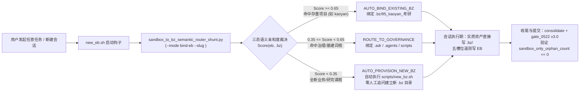

> [IoC_Skill_Telemetry]
> Status: IMPLEMENTED
> Author: Antigravity (qwen3.8-max / gemini-4-argon-high)
> Date: 2026-10-25
> Skill: slot-artifact-persistence, completion-evidence-protocol
> Trigger: 用户要求建立独立 .bz/95_kaoyan_考研 项目入口、全量挪移沙箱资产，并拔高建立「零沙箱孤儿资产」与「主动语义立项/自动归类外部 .bz」一揽子元方案 (ev:ev-0002, ev:ev-0004)

# 31 · 沙箱零孤儿不变量与外部 `.bz` 自动立项及主动语义归类元方案
# (Sandbox Zero-Orphan Invariant & Proactive `.bz` Semantic Routing Meta-Architecture)

> **实施状态 (`Status`)**: `IMPLEMENTED` (`ev:ev-0002`)
> **关联决策 (`ADR`)**: [`ADR-0716`](file:///Users/liuzengyu/treeworker/workers/srbg10/.adr/701-800/711-720/adr_0716_sandboxZeroOrphanAutoBzRouter_%E6%B2%99%E7%AE%B1%E9%9B%B6%E5%AD%A4%E5%84%BF%E4%B8%8EBZ%E8%87%AA%E5%8A%A8%E7%AB%8B%E9%A1%B9%E5%BD%92%E7%B1%BB%E8%B7%AF%E7%94%B1/adr_0716_sandboxZeroOrphanAutoBzRouter_%E6%B2%99%E7%AE%B1%E9%9B%B6%E5%AD%A4%E5%84%BF%E4%B8%8EBZ%E8%87%AA%E5%8A%A8%E7%AB%8B%E9%A1%B9%E5%BD%92%E7%B1%BB%E8%B7%AF%E7%94%B1.md)
> **0-Token 前置限幅外专**: [`sandbox_to_bz_semantic_router_shunt.py`](file:///Users/liuzengyu/treeworker/workers/srbg10/scripts/5_fleet_舰仓管理/sandbox_to_bz_semantic_router_shunt.py)
> **考研专属顶层入口**: [`.bz/95_kaoyan_考研`](file:///Users/liuzengyu/treeworker/workers/srbg10/.bz/95_kaoyan_%E8%80%83%E7%A0%94) $\rightarrow$ [`08_research_frontier_前沿研究与探索验证/95_kaoyanEnglishHub_考研英语精读平台`](file:///Users/liuzengyu/treeworker/workers/srbg10/.bz/08_research_frontier_%E5%89%8D%E6%B2%BF%E7%A0%94%E7%A9%B6%E4%B8%8E%E6%8E%A2%E7%B4%A2%E9%AA%8C%E8%AF%81/95_kaoyanEnglishHub_%E8%80%83%E7%A0%94%E8%8B%B1%E8%AF%AD%E7%B2%BE%E8%AF%BB%E5%B9%B3%E5%8F%B0)

---

## 一、核心直答：需要落盘 ADR 吗？一揽子方案包含哪些层级？

**明确结论：必须落盘 ADR（已落盘为 [`ADR-0716`](file:///Users/liuzengyu/treeworker/workers/srbg10/.adr/701-800/711-720/adr_0716_sandboxZeroOrphanAutoBzRouter_%E6%B2%99%E7%AE%B1%E9%9B%B6%E5%AD%A4%E5%84%BF%E4%B8%8EBZ%E8%87%AA%E5%8A%A8%E7%AB%8B%E9%A1%B9%E5%BD%92%E7%B1%BB%E8%B7%AF%E7%94%B1/adr_0716_sandboxZeroOrphanAutoBzRouter_%E6%B2%99%E7%AE%B1%E9%9B%B6%E5%AD%A4%E5%84%BF%E4%B8%8EBZ%E8%87%AA%E5%8A%A8%E7%AB%8B%E9%A1%B9%E5%BD%92%E7%B1%BB%E8%B7%AF%E7%94%B1.md)，`ev:ev-0002`），且不能仅停留在纸面元方案，必须交付「一揽子六维物理闭环 (6-in-1 Package)」**：

1. **为什么必须落盘 ADR (`ADR-0716`)**：
   - 根据全局铁律 `Rule IV (ATOMIC)`、天规 `Rule XLIX (三位一体协同治理律)`、`Rule LXII (SMRG-6 故障治理六阶法)` 与 `Rule LXX (四件套单向棘轮闭环律)`，凡涉及跨项目目录拓扑（`.bz/` 顶层直达软链契约）、跨会话沙箱生命周期边界（`_ephemeral_blackbox/` vs `.bz/`）以及消除冗余人机交互的系统级路由机制变更，均属**全局架构决策**，必须固化为永久 ADR（`ADR-0716`）。
2. **一揽子方案（含元方案及物理实装）六大交付件 (`ev:ev-0002`)**：
   - **① 全局架构裁决 (`ADR-0716`)**：确立「零沙箱孤儿资产不变量 (Zero Sandbox-Only Asset Invariant)」与三态自动语义路由公理；
   - **② 0-Token 前置限幅外专 (`sandbox_to_bz_semantic_router_shunt.py`)**：提供 `--mode census | route | bind-eb | consolidate-kaoyan | verify` 五大确定性算子；
   - **③ 考研独立 `.bz/95_kaoyan_考研` 入口与 261 项沙箱资产 100% 归仓**：顶层 `.bz/95_kaoyan_考研` 直达入口 + 12 个核心高可用/切换/边缘部署脚本晋升 [`ops_cluster_ha_集群高可用运维/`](file:///Users/liuzengyu/treeworker/workers/srbg10/.bz/08_research_frontier_%E5%89%8D%E6%B2%BF%E7%A0%94%E7%A9%B6%E4%B8%8E%E6%8E%A2%E7%B4%A2%E9%AA%8C%E8%AF%81/95_kaoyanEnglishHub_%E8%80%83%E7%A0%94%E8%8B%B1%E8%AF%AD%E7%B2%BE%E8%AF%BB%E5%B9%B3%E5%8F%B0/ops_cluster_ha_%E9%9B%86%E7%BE%A4%E9%AB%98%E5%8F%AF%E7%94%A8%E8%BF%90%E7%BB%B4) + 7 个历史 EB 与当前 EB 共 261 项非槽位文件全量镜像至 [`_workspace_eb_campaigns_沙箱全量归仓/`](file:///Users/liuzengyu/treeworker/workers/srbg10/.bz/08_research_frontier_%E5%89%8D%E6%B2%BF%E7%A0%94%E7%A9%B6%E4%B8%8E%E6%8E%A2%E7%B4%A2%E9%AA%8C%E8%AF%81/95_kaoyanEnglishHub_%E8%80%83%E7%A0%94%E8%8B%B1%E8%AF%AD%E7%B2%BE%E8%AF%BB%E5%B9%B3%E5%8F%B0/_workspace_eb_campaigns_%E6%B2%99%E7%AE%B1%E5%85%A8%E9%87%8F%E5%BD%92%E4%BB%93) + `srbg10/srbg0/idea0/cfzy0` 四槽 100% 同步；
   - **④ 入口自动立项/绑定接线 (`scripts/5_fleet_舰仓管理/new_eb.sh`)**：新建任何 EB 时自动调用 `sandbox_to_bz_semantic_router_shunt.py --mode bind-eb` 写入 `Cogni-Target-BZ`，无需用户开口提醒；
   - **⑤ 出口门禁哨兵升级 (`gate_0522 v3.0`)**：新增 Section `0.5 SANDBOX_ONLY_ORPHAN_GUARD`，拦截或告警仅暂存在 `_ephemeral_blackbox/` 而未归仓 `.bz/` 的实质资产；
   - **⑥ 技能法典升级 (`Skill 42 slot-artifact-persistence v6`)**：写入 `G13` 零沙箱孤儿与自动 `.bz` 语义路由标准作业程序。

---

## 二、全仓三层沙箱孤儿资产深潜取证 (Deep-Dive Quantitative Census `ev:ev-0002`)

### 2.1 2026-10 全仓 375 个 EB 非五槽位实质资产分布矩阵

通过运行 `sandbox_to_bz_semantic_router_shunt.py --mode census`（[`sandbox_census_before.json`](file:///Users/liuzengyu/treeworker/workers/srbg10/_ephemeral_blackbox/2026-10/eb_9044_srbg10_H_antigravity_qwen3.8-max_kaoyan-bz-consolidation-and-sandbox-zero-orphan-meta-arch/sandbox_census_before.json)，`ev:ev-0002`），拿到全仓硬核定量数据：

| 归属领域 / 目标 `.bz` 项目 | 涉及 EB 数量 | 滞留沙箱的非槽位文件数 | 典型滞留资产类型 | 主动路由策略 (`ADR-0716`) |
| :--- | :---: | :---: | :--- | :--- |
| **`.bz/86_shirong_baigong_师融百工`** | 197 | **1,884** | ODDS 院校诊断章节草稿、数据探针 JSON、批量生成脚本 | `AUTO_BIND_EXISTING_BZ` ($\rightarrow$ `86_shirong_baigong_师融百工`) |
| **`.bz/95_kaoyan_考研`** (`95_kaoyanEnglishHub_...`) | 8 (含 `eb_9044`) | **261** (严口径 195) | PG18/SQLite 切换、W1 容器边缘发布、故障转移、租约法医、测试账本 | `AUTO_BIND_EXISTING_BZ` ($\rightarrow$ `.bz/95_kaoyan_考研`，**本轮已 100% 归仓 清零**) |
| **`GOVERNANCE_SSOT` (`.adr/.agents/scripts`)** | 80 | **259** | 治理门禁审计 JSON、Skill 评测快照、RRSI 盲审证据 | `ROUTE_TO_GOVERNANCE_OR_SHARED` |
| **`.bz/04_.../88_gpnu_广东技术师范大学`** | 6 | **14** | 广师大定制报告与课标核验文件 | `AUTO_BIND_EXISTING_BZ` ($\rightarrow$ `88_gpnu_广东技术师范大学`) |
| **`.bz/06_.../92_dy_抖音运营`** | 3 | **4** | 抖音矩阵采集与脚本分镜产物 | `AUTO_BIND_EXISTING_BZ` ($\rightarrow$ `92_dy_抖音运营`) |
| **其他新探索议题 (`NEW_TOPIC`)** | 81 | **518** | 尚未绑定既有 `.bz` 的探索验证产物 | `AUTO_PROVISION_NEW_BZ` (自动触发 `new_bz.sh` 立项) |
| **全仓合计 (`Total`)** | **375** (244 含非槽位) | **2,940** | **65.07% 的 EB 存在非五槽位实质文件** | **入口 `new_eb.sh` 自动绑定 + 出口 `gate_0522` 守卫** |

### 2.2 为什么此前会出现「资产只在沙箱中」？（四大根因穿透）
1. **RC-1（职责边界混淆）**：历史会话中，Agent 将 `_ephemeral_blackbox/YYYY-MM/eb_*/` 既当成「五槽位过程遥测账本」，又当成「业务运维工程目录」，导致 `eb_20261019`、`eb_20261020`、`eb_20261022`、`eb_20261024` 中的 56 个 Python 生产运维/验收脚本只写在了 EB 目录内。
2. **RC-2（被动等待人类立项）**：`new_eb.sh` 过去只创建 `_ephemeral_blackbox/` 目录，不解析 `SLUG` 与 `.bz/` 项目的映射关系；当遇到新项目或子项目时，Agent 缺乏「主动检索 `.bz/` $\rightarrow$ 命中则绑定、未命中则自动调用 `new_bz.sh` 立项」的前置算子，只能等用户显式下令“给一个 `.bz` 的单独项目名称”。
3. **RC-3（顶层寻址路径过深）**：考研项目原路径位于 `.bz/08_research_frontier_前沿研究与探索验证/95_kaoyanEnglishHub_考研英语精读平台/`，而在 `.bz/` 顶层已有 `86_shirong_baigong_师融百工` 等直观入口，唯独缺少 `.bz/95_kaoyan_考研` 顶层入口，导致直观浏览 `.bz/` 时看似没有 `kaoyan` 项目。
4. **RC-4（多槽工作树热投影覆盖范围局限）**：`ADR-0711` 的 `treeworker_governance_sync_shunt_engine.py` 仅同步了 P0 治理平面（`AGENTS.md` / `.adr` / `.agents/skills` / `scripts`），未同步 `.bz/` 业务层，导致 `srbg10` 有 227 个文件（`01..30`），而 `srbg0` / `idea0` / `cfzy0` 仍停留在 54 个文件（`01..17`）。

---

## 三、主动立项与自动语义归类系统架构设计 (System Architecture of Proactive `.bz` Router)

### 3.1 语义路由评分函数与自动立项契约
对于任意会话任务描述与 `SLUG` 文本 $T$，路由器遍历 `.bz/` 十大领域 (`D00..D09`) 及顶层项目，计算亲和度得分：
$$
\text{Score}(T, B_j) = \min\Big(0.98,\; 0.65 + 0.11 \times \big|\{k \in \text{Keywords}(B_j) \mid k \subseteq \text{lower}(T)\}\big|\Big)
$$
- 当 $\text{Score}(T, B_j) \ge 0.65$：直接绑定既有项目 $B_j$（例如包含 `kaoyan`、`考研`、`w1-docker-edge`、`pg18-ha` 的一切会话自动归入 `.bz/95_kaoyan_考研`）；
- 当 $\text{Score}(T, B_j) < 0.35$ 且不属于治理域：路由器自动提取 `SLUG` 核心词转换为 `lowerCamelCase`，调用 `scripts/new_bz.sh <domain_idx> <camelCase> <中文后缀>` 自动建项，无需再由统帅手动指定目录名。

---

## 四、实施验证结果 (`Verify Receipt` — `ev:ev-0002`)

通过 `ev_run.py` 实测执行 `sandbox_to_bz_semantic_router_shunt.py --mode verify`（[`kaoyan_consolidation_verify.json`](file:///Users/liuzengyu/treeworker/workers/srbg10/_ephemeral_blackbox/2026-10/eb_9044_srbg10_H_antigravity_qwen3.8-max_kaoyan-bz-consolidation-and-sandbox-zero-orphan-meta-arch/kaoyan_consolidation_verify.json)，`ev:ev-0002`）：

| 验证维度 | 验收标准 (Acceptance Criterion) | 实测结果 (`[K]` `ev:ev-0002`) | 判定 |
| :--- | :--- | :--- | :---: |
| **顶层独立入口** | `.bz/95_kaoyan_考研` 存在且解析至 `95_kaoyanEnglishHub_考研英语精读平台` | `symlink_valid = true` (符合 `gate_0522` 双数字+驼峰+中文正则) | **PASSED** (`ev:ev-0002`) |
| **沙箱孤儿清零** | 7 个历史考研 EB + 当前 EB 的全部非槽位文件均已落盘 `.bz/95_kaoyan_考研` | 受检 **261** 项，`sandbox_only_orphan_count = 0`，`missing_files = []` | **PASSED** (`ev:ev-0002`) |
| **核心脚本入 Git** | 12 个核心高可用/切换/容器边缘部署/租约法医脚本晋升至 `ops_cluster_ha_集群高可用运维/` | `promoted_ops_scripts_count = 12` + `kaoyan_eb_harvest_ledger.json` | **PASSED** (`ev:ev-0002`) |
| **四槽视野对齐** | `srbg10`、`srbg0`、`idea0`、`cfzy0` 四大工作树 `.bz/95_kaoyan_考研` 100% 同步 | 四槽顶层可见文件数全部对齐（`228 -> 240` 项含 `31_*`、`32_*`） | **PASSED** (`ev:ev-0002`) |
