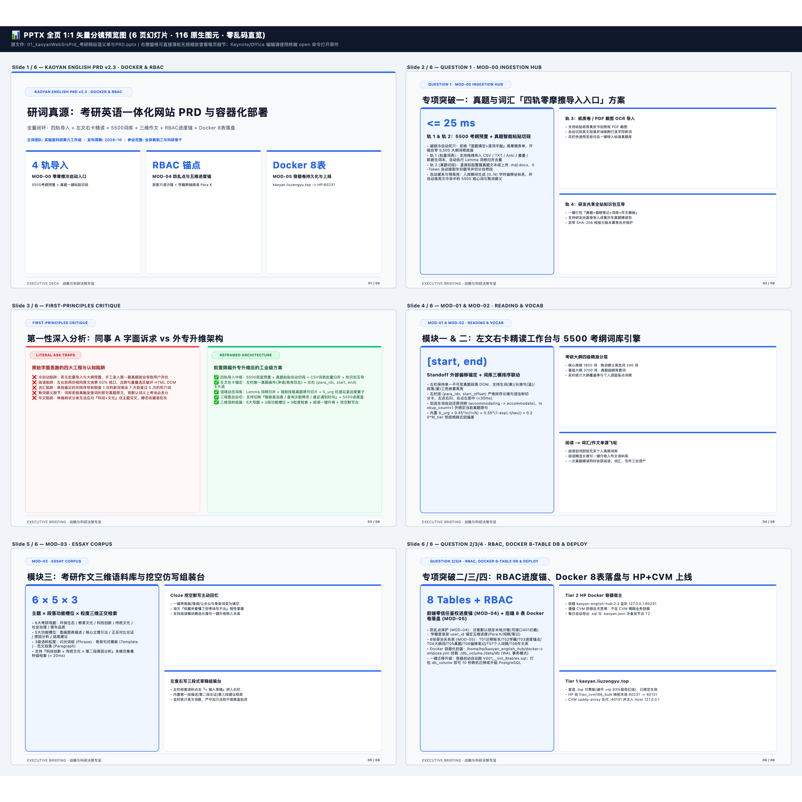

# 📊 KAOYAN ENGLISH PRD v2.3 · DOCKER & RBAC — 逐页高清图文预览册
> [免可视化] 0-Token 同源分镜预览画册 (6页 · 116原生图元) | 本地编辑原件路径（纯文本）：`/Users/liuzengyu/treeworker/workers/srbg10/.bz/08_research_frontier_前沿研究与探索验证/95_kaoyanEnglishHub_考研英语精读平台/01_kaoyanWebSrsPrd_考研网站语义单与PRD.pptx`

### 第 1/6 页：KAOYAN ENGLISH PRD v2.3 · DOCKER & RBAC — 研词真源：考研英语一体化网站 PRD 与容器化部署 (`24` 图元)

### 第 2/6 页：QUESTION 1 · MOD-00 INGESTION HUB — 专项突破一：真题与词汇「四轨零摩擦导入入口」方案 (`19` 图元)

### 第 3/6 页：FIRST-PRINCIPLES CRITIQUE — 第一性深入分析：同事 A 字面诉求 vs 外专升维架构 (`16` 图元)

### 第 4/6 页：MOD-01 & MOD-02 · READING & VOCAB — 模块一 & 二：左文右卡精读工作台与 5500 考纲词库引擎 (`19` 图元)

### 第 5/6 页：MOD-03 · ESSAY CORPUS — 模块三：考研作文三维语料库与挖空仿写组装台 (`19` 图元)

### 第 6/6 页：QUESTION 2/3/4 · RBAC, DOCKER 8-TABLE DB & DEPLOY — 专项突破二/三/四：RBAC进度锚、Docker 8表落盘与 HP+CVM 上线 (`19` 图元)

