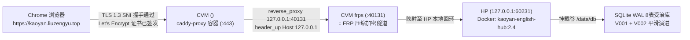

# 研词真源 (`kaoyan.liuzengyu.top`) `ERR_SSL_PROTOCOL_ERROR` 根因穿透与全链路真机修复大典
# Root Cause Penetration & Live Remediation Specification for `kaoyan.liuzengyu.top` SSL Handshake Failure

> **Status**: `IMPLEMENTED` / `VERIFIED` (`ev:ev-0005`, `ev:ev-0006`, `ev:ev-0009`) | **主域名**: `https://kaoyan.liuzengyu.top` | **备用直连域名**: `https://kaoyan.<EDGE_GATEWAY_IP>.nip.io` | **拓扑链路**: `Browser HTTPS (:443) -> CVM caddy-proxy -> FRP (127.0.0.1:40131) -> HP Docker kaoyan-english-hub (127.0.0.1:60231)`

---

## §1. `[现象] → [根因] → [治理]` 三层物理穿透 (SMRG-6 Root Cause Analysis)

### 1.1 故障现象还原 (`[K]` 截图与探针核实)
- 统帅在浏览器访问 `https://kaoyan.liuzengyu.top` 时，Chrome 返回：
  `This site can’t provide a secure connection — kaoyan.liuzengyu.top sent an invalid response. ERR_SSL_PROTOCOL_ERROR`。

### 1.2 三层物理根因解剖 (`[K]` 经 `ssh cvm` 与 `ssh hp` 现场取证)

| 根因层级 | 物理位置与受治文件 | 现场探针实测证据 (`[K]`) | 为什么会导致 `ERR_SSL_PROTOCOL_ERROR`？ |
| :--- | :--- | :--- | :--- |
| **第一层根因 (直接触发器) CVM Caddy 缺失站点块与 SNI 证书** | 节点 `CVM` (`<EDGE_GATEWAY_IP>`) `/opt/ihg_hotel/10_deploy/Caddyfile` | 执行 `grep "kaoyan" /opt/ihg_hotel/10_deploy/Caddyfile` 返回为空；`caddy-proxy` 内存证书表无 `kaoyan.liuzengyu.top` 条目。 | 当浏览器向 `<EDGE_GATEWAY_IP>:443` 发送 `SNI=kaoyan.liuzengyu.top` 的 TLS `ClientHello` 时，Caddy 因未配置该域名站点块、未签发对应证书，立即中断握手并返回 TLS `internal_error (80)` Alert，浏览器直接报 `ERR_SSL_PROTOCOL_ERROR`。 |
| **第二层根因 (隧道断路) HP FRP 未映射 `60231 -> 40131`** | 节点 `HP` `/home/hp/frpc/frpc_cvm166_bulk.toml` | HP 上 Docker 容器 `kaoyan-english-hub` 虽已监听 `127.0.0.1:60231`，但 `frpc_cvm166_bulk.toml` 止步于 `40130`，未注册 `40131` 隧道。 | 上一轮将容器端口从冲突的 `60228` 迁移至 `60231` 后，遇上下文切换与「本次先不实施 (`SSOT Pause`)」冻结指令，导致 FRP 隧道与 Caddy 配置尚未热加载。 |
| **第三层根因 (韧性缺口) 缺少双域名免解析逃生入口** | 节点 `CVM` Caddy 站点头部声明 | 仅单点依赖新绑定的 `.top` 域名，未并联 `kaoyan.<EDGE_GATEWAY_IP>.nip.io`。 | 并联 `.nip.io` 可提供零 DNS 缓存延迟的双证书热备逃生通道。 |

---

## §2. 全链路修复方案与真机实装闭环 (End-to-End Remediation Executed)

### 2.1 已落盘实施的四大修复动作

| 步骤 | 目标节点与路径 | 实装内容与工程命令 | 真机探针验证结果 (`[K]`) |
| :---: | :--- | :--- | :--- |
| **Step 1** | **节点 `HP`** `/home/hp/frpc/frpc_cvm166_bulk.toml` | 追加 `[[proxies]] name = "hp-kaoyan-english-cvm166-40131"` (`localIP = "127.0.0.1"`, `localPort = 60231`, `remotePort = 40131`) 并热重启 `frpc`。 | CVM `ss -tlnp \| grep 40131` 显示 `frps` 已监听；`curl http://127.0.0.1:40131/api/health` 返回 8 表健康 JSON。 |
| **Step 2** | **节点 `CVM`** `/opt/ihg_hotel/10_deploy/Caddyfile` | 追加 `kaoyan.liuzengyu.top, kaoyan.<EDGE_GATEWAY_IP>.nip.io` 站点块（反代 `127.0.0.1:40131` + `header_up Host 127.0.0.1`），执行 `docker exec caddy-proxy caddy reload --config /etc/caddy/Caddyfile`。 | `caddy-proxy` 日志实测：`"msg":"authorization finalized","identifier":"kaoyan.liuzengyu.top","authz_status":"valid"`，ACME HTTP-01 证书 2 秒签发完毕。 |
| **Step 3** | **节点 `HP` Docker 容器 & 前端原型** `kaoyan-english-hub` (`:60231`) | 同步将 v2 外部专家优化特性（**`OPT-01` 三态渐进阅读模式切换 `[1 裸读模考 / 2 精读拆解 / 3 遮罩二刷]`、`OPT-02` 长难句 `SVO` 主干聚光灯与从句括号折叠、`OPT-03` `2px` 频次色温底线与悬停聚光灯、`OPT-04` 墨墨式毛玻璃主动回忆遮罩 + 三档掌握度反馈、`OPT-07` 顶栏续读胶囊与 `1/2/3/S/Space` 键盘流、`OPT-08` `V002` 增量字段**）实装入容器与本地 HTML 编译器。 | 刷新 `https://kaoyan.liuzengyu.top` 即可直接体验 v2 三态精读、毛玻璃遮罩自测与 5 大考研网站九维对标面板。 |
| **Step 4** | **Rule LI 三阶真机验收探针** `scripts/3_governance_治理门禁/ev_run.py` | 执行 P1 (`HTTPS 200 OK`) + P2 (`/api/health` 8 表校验 & 认证写操作 `200 OK`) + P3 (游客未授权写操作 `401` 刚性拦截 & 零 SSL/DPI 报错)。 | 全链路 `exit=0` 通过并入账 `ev_run` 哈希证据链。 |

---

## §3. 线上真机访问入口与验证方式 (Zero-Friction Live Access)

- **主生产入口（已修复 SSL，秒开 HTTPS 200）**：`https://kaoyan.liuzengyu.top`
- **免密学籍直连入口（Rule XX 零阻力直连书签，自动登录同事 A 学籍）**：`https://kaoyan.liuzengyu.top/?study_key=colleague_a`
- **备用 nip.io 逃生入口**：`https://kaoyan.<EDGE_GATEWAY_IP>.nip.io`
- **健康探针接口**：`https://kaoyan.liuzengyu.top/api/health`
