# 主机 `elena` (`<APP_SERVER_IP>`) 安全加固、`User=elena` 非 Root 部署、40GB 磁盘防爆冷热分层与 `T2` (`19TB /vol1`) 归档大典
# Host `elena` (`<APP_SERVER_IP>`) SSH Hardening, Non-Root `elena` Deployment, 40GB Anti-Explosion Hot/Cold Tiering & `T2` Cold Archive Specification

> **Status**: `IMPLEMENTED` / `VERIFIED` (`ev:ev-0012`, `ev:ev-0013`, `ev:ev-0015`) | **目标主机**: `elena` (`<APP_SERVER_IP>`, Ubuntu 26.04 LTS) | **运行账号**: **`elena` (`uid=1000, User=elena, Group=elena`，严禁 `root` 裸跑业务)** | **冷备目标**: `T2` (`<COLD_BACKUP_NAS_IP>:39810` -> `/vol1/backup/elena_kaoyan_cold_archive/`)

---

## §1. 账号与 SSH 安全基线实装核验 (`ev:ev-0012`, `ev:ev-0013`, `ev:ev-0015`)

### 1.1 针对统帅核心追问的物理核验结论 (`[K]` 实测)
> **统帅追问**：「部署在 `kaoyan.elenalyl.top` 的项目，是通过普通账号 `elena` 部署的？还是 `root` 部署的？要是 `elena` 才对的」
> **物理实测回答 (`ev:ev-0015`)**：**100% 由普通账号 `elena` 部署并运行！**
> - 代码与前端资产目录：`/home/elena/kaoyan_english_hub/`（属主 `elena:elena`）
> - 冷热分层数据根目录：`/home/elena/kaoyan_storage/`（属主 `elena:elena`）
> - Systemd 服务契约：`/etc/systemd/system/kaoyan-english-hub.service` 显式锁定 `User=elena`、`Group=elena`，实测 `ps -o user= -p $(pgrep -f kaoyan_hub_server.py)` 返回 **`elena`** (`ev:ev-0015`)。
> - 定时冷备任务 (`crontab -l`) 與 `elena -> t2` 免密密钥 (`/home/elena/.ssh/id_ed25519`) 全部挂载于普通账号 `elena` 名下，零 `root` 业务进程。

### 1.2 四项主机安全与免密拓扑实装表

| 序号 | 治理项 | 物理落盘位置 | 实测生效状态 (`[K]`) | 证据编号 |
| :---: | :--- | :--- | :--- | :---: |
| **1** | **M4 公钥注入 `<APP_SERVER_IP>`** | `<APP_SERVER_IP>:/root/.ssh/authorized_keys` & `/home/elena/.ssh/authorized_keys` | M4 本地 4 把公钥全量幂等写入，权限 `700 / 600` | `ev:ev-0012` |
| **2** | **禁止 `root` 密码直接 SSH 登录** | `<APP_SERVER_IP>:/etc/ssh/sshd_config` (`PermitRootLogin prohibit-password`, `PasswordAuthentication no`) | `sshd -T` 实测生效；负向探针用密码连接 `root@<APP_SERVER_IP>` 被立即拒绝 | `ev:ev-0013` |
| **3** | **创建 `elena` 普通账号 + 免密 `sudo` + 主机命名 `elena`** | `/etc/sudoers.d/90-elena-nopasswd` + `hostnamectl set-hostname elena` + M4 `~/.ssh/config` (`Host elena`) | M4 直接执行 `ssh elena` 秒进 `elena@elena:~$`，`sudo -n whoami` 返回 `root` | `ev:ev-0013` |
| **4** | **配置 `elena (<APP_SERVER_IP>) -> t2` 免密登录** | `elena:/home/elena/.ssh/id_ed25519` + `elena:/home/elena/.ssh/config` (`Host t2 -> <COLD_BACKUP_NAS_IP>:39810`) -> `t2:~/.ssh/authorized_keys` | 在 `elena` 账号下直接执行 `ssh t2` 免密直通节点 `T2` (`jasper@t2`) | `ev:ev-0015` |

---

## §2. 部署前磁盘容量勘测与「零磁盘爆炸」四区配额规划 (`elena` vs `T2`)

### 2.1 双节点物理磁盘探针勘测表 (`[K]` 实测，杜绝盲目写入爆盘)

| 节点与角色 | 文件系统与挂载点 | 总容量 (`Size`) | 已用 (`Used`) | 可用 (`Avail`) | 使用率 | **防磁盘爆炸关键架构裁决** |
| :--- | :--- | :---: | :---: | :---: | :---: | :--- |
| **`elena` (`<APP_SERVER_IP>`)** 前后端生产宿主 | `/dev/vda3` 挂载于 `/` | `39.8 GB` | `3.0 GB` | **`34.8 GB`** | `8%` | 云盘总容量 40GB，必须严格限制系统日志 (`journald <= 200MB`)、限制本地快照保留期 ($\le 7$ 天)，并将历史备份与原始图片/PDF 卸载至 `T2`。 |
| **`T2` (校园网冷备节点)** 🚨 **系统盘高危预警** | `/dev/sda2` 挂载于 `/` (含 `/home/jasper`) | `14.0 GB` | `8.7 GB` | **`4.6 GB`** | **`66%`** | 🔴 **绝对红线**：`T2` 根分区仅剩 `4.6 GB`！**严禁**将任何备份文件直接写入 `/home/jasper` 实体目录，否则数次备份即撑爆 `T2` 系统盘！ |
| **`T2` (校园网冷备节点)** 🟢 **19TB 冷备主阵地** | `/dev/mapper/trim...` 挂载于 **`/vol1`** (Btrfs RAID1) | **`19.0 TB`** | `2.6 TB` | **`16.0 TB`** | `14%` | 🟢 **唯一合法冷备落盘区**：在 `/vol1/backup/elena_kaoyan_cold_archive/` 建立冷归档主目录（并在 `~/elena_kaoyan_cold_archive` 建软链指向 `/vol1`），零占用根分区！ |

---

## §3. 冷热数据三层划分标准与目录映射矩阵 (Hot / Warm / Cold Data Classification)

```mermaid
flowchart LR
    H["🔥 热数据层 (TIER_HOT <= 4GB)<br/>elena:/home/elena/kaoyan_storage/hot_db/<br/>kaoyan_hub.sqlite3 (8张活跃表 WAL)"] -->|"每日 03:30 WAL Checkpoint<br/>导出 SQL 快照"| W["🌤️ 温数据层 (TIER_WARM <= 2GB)<br/>elena:/home/elena/kaoyan_storage/warm_staging/<br/>近7天快照 + 24h OCR临时图片缓冲"]
    W -->|"gzip 高比压缩 + SHA-256 校验<br/>清理本地 >7d 文件"| C["❄️ 冷数据发件箱 (TIER_COLD <= 500MB)<br/>elena:/home/elena/kaoyan_storage/cold_outbox/"]
    C -->|"elena -> t2 免密 SCP/Rsync<br/>跨节点加密传输"| T["🏔️ T2 19TB Btrfs 永久冷备池<br/>t2:/vol1/backup/elena_kaoyan_cold_archive/<br/>sql_archives/ + raw_media_archive/ + manifests/"]
```

| 数据分层 | 业务与表级数据定义 (`Data Scope`) | `elena` (`<APP_SERVER_IP>`) 本地路径 (属主 `elena:elena`) | 本地配额上限与淘汰策略 | `T2` 归档目标路径 (`/vol1` 19TB 阵列) |
| :--- | :--- | :--- | :--- | :--- |
| **🔥 热数据 (`TIER_HOT`)** | 高频读写核心状态：`T01` 迁移账本、`T02` 学籍账户、`T03` 五维阅读进度锚点、`T04` 5500考纲底座、`T05` 当季真题篇章、`T06` 活跃精读卡片、`T07` 未熟记高危生词 (`S_urg`)、`T08` 常用作文模板。 | `/home/elena/kaoyan_storage/hot_db/kaoyan_hub.sqlite3` | **上限 `4.0 GB`** 常驻 NVMe/SSD 内存热缓存，每日自动执行 `PRAGMA wal_checkpoint(TRUNCATE)` 防止 `-wal` 文件无限膨胀。 | 实时热库不直接裸拷，经一致性 Checkpoint 转为快照后归档。 |
| **🌤️ 温数据 (`TIER_WARM`)** | ① 最近 7 天内的每日 `.sql` 全量转储与 `.kaoyan.json` 知识包； ② Track 3 用户上传待校对的真题截图/PDF 临时缓存。 | `/home/elena/kaoyan_storage/warm_staging/daily_snapshots/` `/home/elena/kaoyan_storage/warm_staging/ocr_intake_tmp/` | **上限 `2.0 GB`** 本地仅保留最近 **7 天** 快照；OCR 临时图片在提取完英文文本满 **24 小时** 后自动转冷清理。 | 满 7 天自动沉降为 `.sql.gz` 归档包迁入 `T2`。 |
| **❄️ 冷数据 (`TIER_COLD`)** | ① **历史全量快照 (`>7天`)**：压缩后的 `kaoyan_cold_archive_*.sql.gz`； ② **已解析完毕的原始试卷扫描件/截图 (`raw_media`)**； ③ **已彻底掌握销账的历史词频流水 (`mastery_state='ARCHIVED'`)**。 | `/home/elena/kaoyan_storage/cold_outbox/{sql_archives,raw_media_archive,ledger_slices}/` | **上限 `500 MB`** 同步至 `T2` 并校验 SHA-256 一致后，本地仅留最近 3 份存根，释放 `elena` 磁盘空间。 | **`/vol1/backup/elena_kaoyan_cold_archive/`** (`sql_archives/`, `raw_media_archive/`, `ledger_slices/`, `manifests/latest_manifest.json`) |

---

## §4. 自动化冷备实装验证与 `kaoyan.elenalyl.top` 接入说明 (`ev:ev-0015`)

1. **冷备守护脚本与定时任务（运行于 `User=elena`）**：
   - 脚本路径：`elena:/home/elena/kaoyan_english_hub/elena_cold_offload_to_t2.py`
   - 定时调度（`elena` 用户 crontab）：`30 3 * * * /usr/bin/python3 /home/elena/kaoyan_english_hub/elena_cold_offload_to_t2.py`
   - 首次实测归档产物 (`ev:ev-0015`)：已在 `T2` 生成 `/vol1/backup/elena_kaoyan_cold_archive/sql_archives/kaoyan_cold_archive_*.sql.gz` 与 `/vol1/backup/elena_kaoyan_cold_archive/manifests/latest_manifest.json`（`elena` 磁盘占用仅 `8.06%`）。
2. **`kaoyan.elenalyl.top` 在 `<APP_SERVER_IP>` 的网关状态与云安全组提示**：
   - `<APP_SERVER_IP>` 本地 Caddy (`:80/:443`) 与 `kaoyan-english-hub.service` (`127.0.0.1:60231`) 已 100% 启动就绪，`curl -H "Host: kaoyan.elenalyl.top" http://127.0.0.1/api/health` 返回 8 表健康 JSON (`ev:ev-0015`)。
   - **物理探针提示 (`[K]`)**：外部探针检测到阿里云 ECS (`<APP_SERVER_IP>`) 云安全组当前仅放行了 TCP `22` 端口（外部访问 `<APP_SERVER_IP>:80/443` 被云安全组拦截），且 `kaoyan.elenalyl.top` 公网 DNS A 记录正在生效中。统帅在阿里云控制台安全组放行 `80/443` 端口后，`https://kaoyan.elenalyl.top` 将自动完成 Let's Encrypt 证书签发并对外秒开。

<!-- [IoC_Revision_v1] Status: VERIFIED (ev:ev-0012, ev:ev-0013, ev:ev-0015); Evidence: ev:ev-0012, ev:ev-0013, ev:ev-0015 -->
