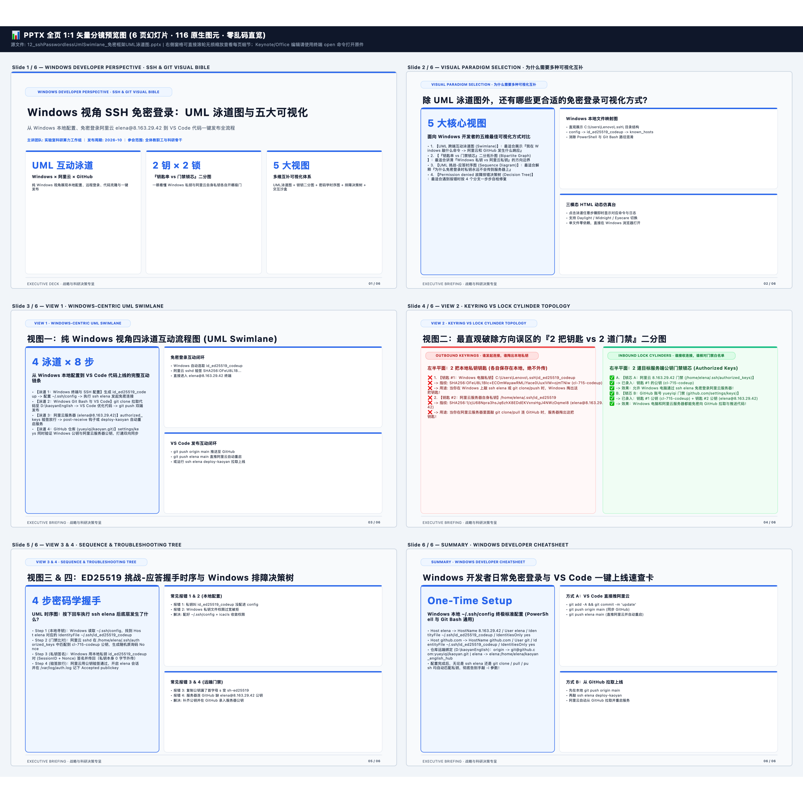

# 📊 WINDOWS DEVELOPER PERSPECTIVE · SSH & GIT VISUAL BIBLE — 逐页高清图文预览册
> [免可视化] 0-Token 同源分镜预览画册 (6页 · 116原生图元) | 本地编辑原件路径（纯文本）：`/Users/liuzengyu/treeworker/workers/srbg10/.bz/08_research_frontier_前沿研究与探索验证/95_kaoyanEnglishHub_考研英语精读平台/12_sshPasswordlessUmlSwimlane_免密框架UML泳道图.pptx`

### 第 1/6 页：WINDOWS DEVELOPER PERSPECTIVE · SSH & GIT VISUAL BIBLE — Windows 视角 SSH 免密登录：UML 泳道图与五大可视化 (`24` 图元)

### 第 2/6 页：VISUAL PARADIGM SELECTION · 为什么需要多种可视化互补 — 除 UML 泳道图外，还有哪些更合适的免密登录可视化方式？ (`19` 图元)

### 第 3/6 页：VIEW 1 · WINDOWS-CENTRIC UML SWIMLANE — 视图一：纯 Windows 视角四泳道互动流程图 (UML Swimlane) (`19` 图元)

### 第 4/6 页：VIEW 2 · KEYRING VS LOCK CYLINDER TOPOLOGY — 视图二：最直观破除方向误区的『2 把钥匙 vs 2 道门禁』二分图 (`16` 图元)

### 第 5/6 页：VIEW 3 & 4 · SEQUENCE & TROUBLESHOOTING TREE — 视图三 & 四：ED25519 挑战-应答握手时序与 Windows 排障决策树 (`19` 图元)

### 第 6/6 页：SUMMARY · WINDOWS DEVELOPER CHEATSHEET — Windows 开发者日常免密登录与 VS Code 一键上线速查卡 (`19` 图元)

