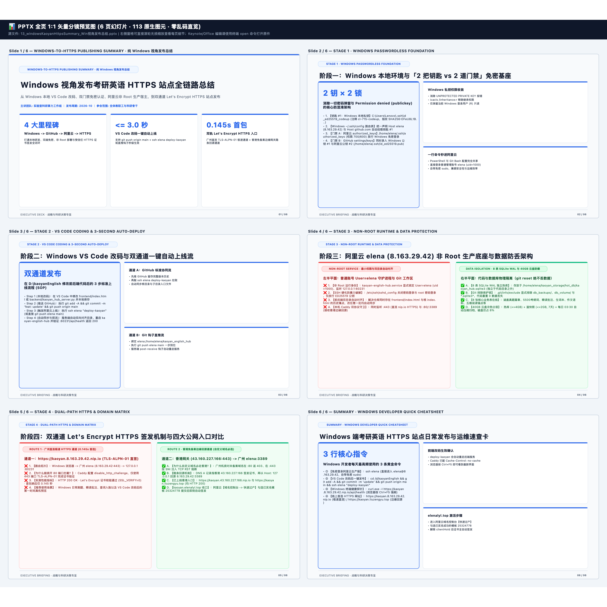

# 📊 WINDOWS-TO-HTTPS PUBLISHING SUMMARY · 纯 Windows 视角发布总结 — 逐页高清图文预览册
> [免可视化] 0-Token 同源分镜预览画册 (6页 · 113原生图元) | 本地编辑原件路径（纯文本）：`/Users/liuzengyu/treeworker/workers/srbg10/.bz/08_research_frontier_前沿研究与探索验证/95_kaoyanEnglishHub_考研英语精读平台/13_windowsKaoyanHttpsSummary_Win视角发布总结.pptx`

### 第 1/6 页：WINDOWS-TO-HTTPS PUBLISHING SUMMARY · 纯 Windows 视角发布总结 — Windows 视角发布考研英语 HTTPS 站点全链路总结 (`24` 图元)

### 第 2/6 页：STAGE 1 · WINDOWS PASSWORDLESS FOUNDATION — 阶段一：Windows 本地环境与「2 把钥匙 vs 2 道门禁」免密基座 (`19` 图元)

### 第 3/6 页：STAGE 2 · VS CODE CODING & 3-SECOND AUTO-DEPLOY — 阶段二：Windows VS Code 改码与双通道一键自动上线流 (`19` 图元)

### 第 4/6 页：STAGE 3 · NON-ROOT RUNTIME & DATA PROTECTION — 阶段三：阿里云 elena (8.163.29.42) 非 Root 生产底座与数据防丢架构 (`16` 图元)

### 第 5/6 页：STAGE 4 · DUAL-PATH HTTPS & DOMAIN MATRIX — 阶段四：双通道 Let's Encrypt HTTPS 签发机制与四大公网入口对比 (`16` 图元)

### 第 6/6 页：SUMMARY · WINDOWS DEVELOPER QUICK CHEATSHEET — Windows 端考研英语 HTTPS 站点日常发布与运维速查卡 (`19` 图元)

