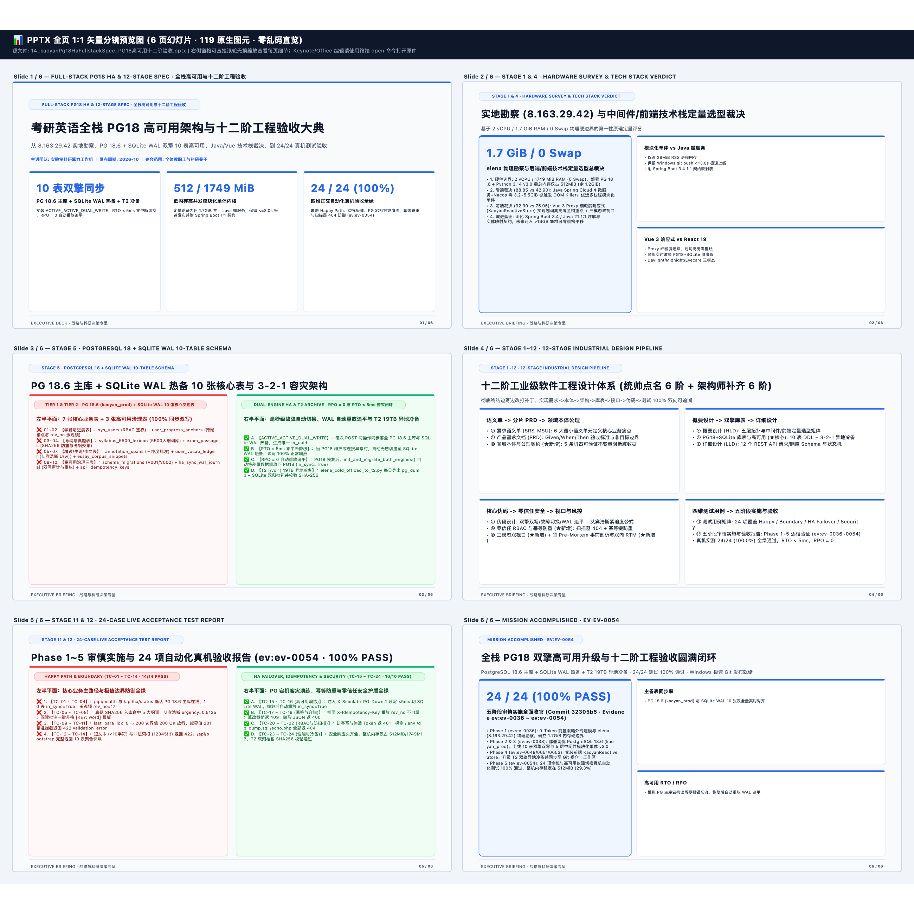

# 📊 FULL-STACK PG18 HA & 12-STAGE SPEC · 全栈高可用与十二阶工程验收 — 逐页高清图文预览册
> [免可视化] 0-Token 同源分镜预览画册 (6页 · 119原生图元) | 本地编辑原件路径（纯文本）：`/Users/liuzengyu/treeworker/workers/srbg10/.bz/08_research_frontier_前沿研究与探索验证/95_kaoyanEnglishHub_考研英语精读平台/14_kaoyanPg18HaFullstackSpec_PG18高可用十二阶验收.pptx`

### 第 1/6 页：FULL-STACK PG18 HA & 12-STAGE SPEC · 全栈高可用与十二阶工程验收 — 考研英语全栈 PG18 高可用架构与十二阶工程验收大典 (`24` 图元)

### 第 2/6 页：STAGE 1 & 4 · HARDWARE SURVEY & TECH STACK VERDICT — 实地勘察 (8.163.29.42) 与中间件/前端技术栈定量选型裁决 (`20` 图元)

### 第 3/6 页：STAGE 5 · POSTGRESQL 18 + SQLITE WAL 10-TABLE SCHEMA — PG 18.6 主库 + SQLite WAL 热备 10 张核心表与 3-2-1 容灾架构 (`16` 图元)

### 第 4/6 页：STAGE 1~12 · 12-STAGE INDUSTRIAL DESIGN PIPELINE — 十二阶工业级软件工程设计体系 (统帅点名 6 阶 + 架构师补齐 6 阶) (`23` 图元)

### 第 5/6 页：STAGE 11 & 12 · 24-CASE LIVE ACCEPTANCE TEST REPORT — Phase 1~5 审慎实施与 24 项自动化真机验收报告 (ev:ev-0054 · 100% PASS) (`16` 图元)

### 第 6/6 页：MISSION ACCOMPLISHED · EV:EV-0054 — 全栈 PG18 双擎高可用升级与十二阶工程验收圆满闭环 (`20` 图元)

