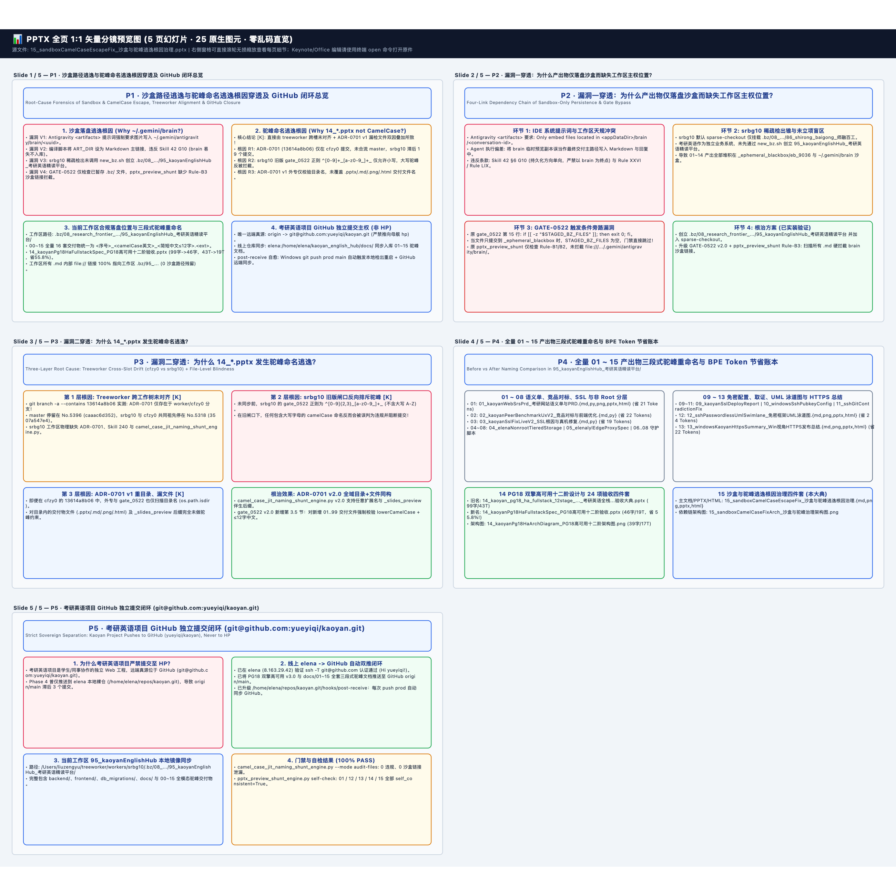

# 📊 P1 · 沙盒路径逃逸与驼峰命名逃逸根因穿透及 GitHub 闭环总览 — 逐页高清图文预览册
> [免可视化] 0-Token 同源分镜预览画册 (5页 · 25原生图元) | 本地编辑原件路径（纯文本）：`/Users/liuzengyu/treeworker/workers/srbg10/.bz/08_research_frontier_前沿研究与探索验证/95_kaoyanEnglishHub_考研英语精读平台/15_sandboxCamelCaseEscapeFix_沙盒与驼峰逃逸根因治理.pptx`

### 第 1/5 页：P1 · 沙盒路径逃逸与驼峰命名逃逸根因穿透及 GitHub 闭环总览 — Root-Cause Forensics of Sandbox & CamelCase Escape, Treeworker Alignment & GitHub Closure (`5` 图元)

### 第 2/5 页：P2 · 漏洞一穿透：为什么产出物仅落盘沙盒而缺失工作区主权位置？ — Four-Link Dependency Chain of Sandbox-Only Persistence & Gate Bypass (`5` 图元)

### 第 3/5 页：P3 · 漏洞二穿透：为什么 14_*.pptx 发生驼峰命名逃逸？ — Three-Layer Root Cause: Treeworker Cross-Slot Drift (cfzy0 vs srbg10) + File-Level Blindness (`5` 图元)

### 第 4/5 页：P4 · 全量 01 ~ 15 产出物三段式驼峰重命名与 BPE Token 节省账本 — Before vs After Naming Comparison in 95_kaoyanEnglishHub_考研英语精读平台/ (`5` 图元)

### 第 5/5 页：P5 · 考研英语项目 GitHub 独立提交闭环 (git@github.com:yueyiqi/kaoyan.git) — Strict Sovereign Separation: Kaoyan Project Pushes to GitHub (yueyiqi/kaoyan), Never to HP (`5` 图元)

