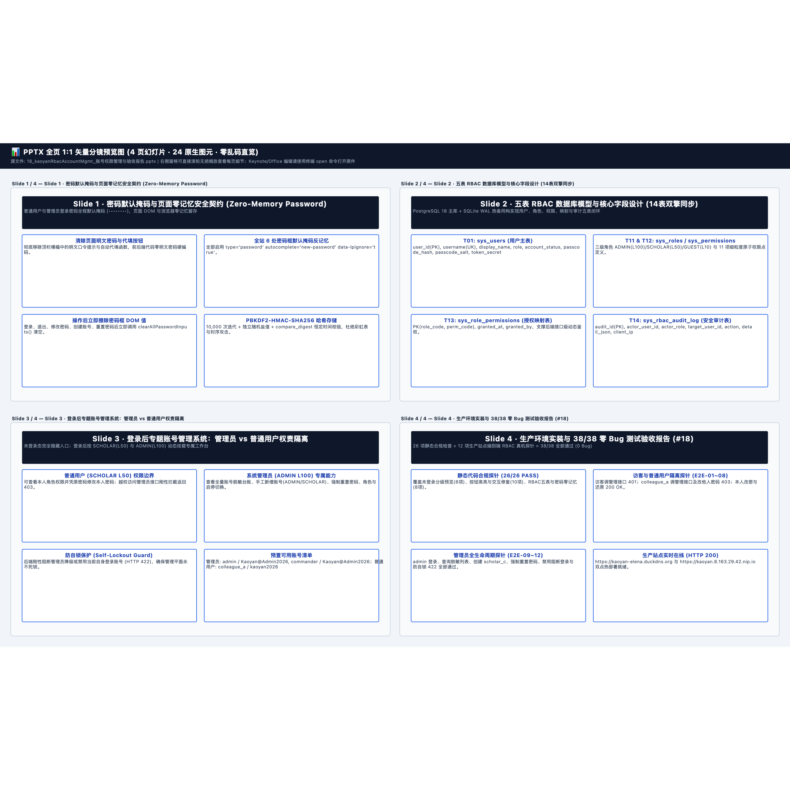

# 📊 Slide 1 · 密码默认掩码与页面零记忆安全契约 (Zero-Memory Password) — 逐页高清图文预览册
> [免可视化] 0-Token 同源分镜预览画册 (4页 · 24原生图元) | 本地编辑原件路径（纯文本）：`/Users/liuzengyu/treeworker/workers/srbg10/.bz/08_research_frontier_前沿研究与探索验证/95_kaoyanEnglishHub_考研英语精读平台/18_kaoyanRbacAccountMgmt_账号权限管理与验收报告.pptx`

### 第 1/4 页：Slide 1 · 密码默认掩码与页面零记忆安全契约 (Zero-Memory Password) — 普通用户与管理员登录密码全程默认掩码 (••••••••)，页面 DOM 与浏览器零记忆留存 (`6` 图元)

### 第 2/4 页：Slide 2 · 五表 RBAC 数据库模型与核心字段设计 (14表双擎同步) — PostgreSQL 18 主库 + SQLite WAL 热备同构实现用户、角色、权限、映射与审计五表闭环 (`6` 图元)

### 第 3/4 页：Slide 3 · 登录后专题账号管理系统：管理员 vs 普通用户权责隔离 — 未登录态完全隐藏入口；登录后按 SCHOLAR(L50) 与 ADMIN(L100) 动态挂载专属工作台 (`6` 图元)

### 第 4/4 页：Slide 4 · 生产环境实装与 38/38 零 Bug 测试验收报告 (#18) — 26 项静态合规检查 + 12 项生产站点端到端 RBAC 真机探针 = 38/38 全部通过 (0 Bug) (`6` 图元)

