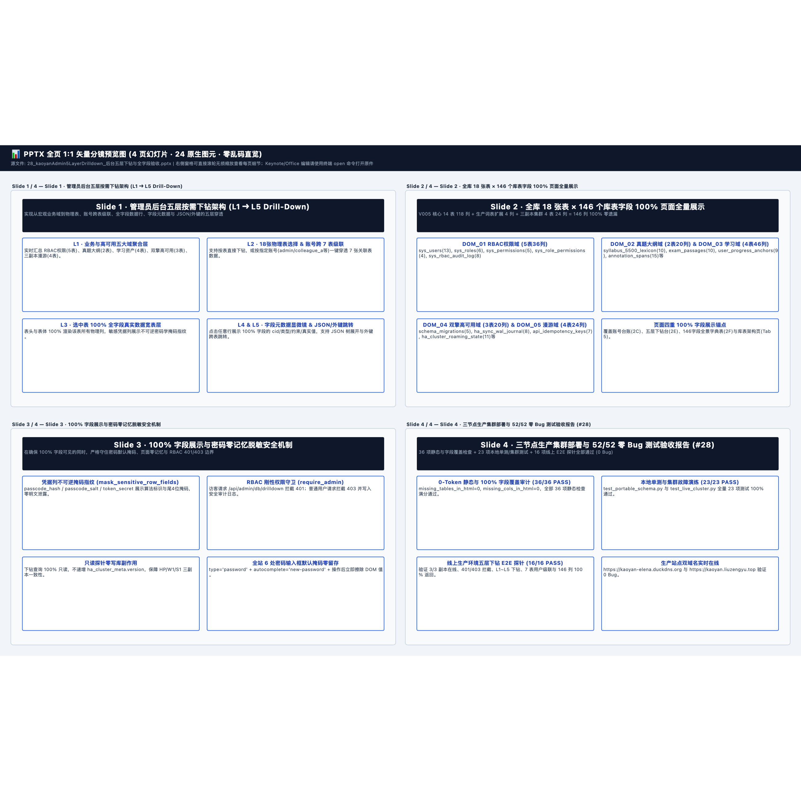

# 📊 Slide 1 · 管理员后台五层按需下钻架构 (L1 ➔ L5 Drill-Down) — 逐页高清图文预览册
> [免可视化] 0-Token 同源分镜预览画册 (4页 · 24原生图元) | 本地编辑原件路径（纯文本）：`/Users/liuzengyu/treeworker/workers/srbg10/.bz/08_research_frontier_前沿研究与探索验证/95_kaoyanEnglishHub_考研英语精读平台/28_kaoyanAdmin5LayerDrilldown_后台五层下钻与全字段验收.pptx`

### 第 1/4 页：Slide 1 · 管理员后台五层按需下钻架构 (L1 ➔ L5 Drill-Down) — 实现从宏观业务域到物理表、账号跨表级联、全字段数据行、字段元数据与 JSON/外键的五层穿透 (`6` 图元)

### 第 2/4 页：Slide 2 · 全库 18 张表 × 146 个库表字段 100% 页面全量展示 — V005 核心 14 表 118 列 + 生产词表扩展 4 列 + 三副本集群 4 表 24 列 = 146 列 100% 零遗漏 (`6` 图元)

### 第 3/4 页：Slide 3 · 100% 字段展示与密码零记忆脱敏安全机制 — 在确保 100% 字段可见的同时，严格守住密码默认掩码、页面零记忆与 RBAC 401/403 边界 (`6` 图元)

### 第 4/4 页：Slide 4 · 三节点生产集群部署与 52/52 零 Bug 测试验收报告 (#28) — 36 项静态与字段覆盖检查 + 23 项本地单测/集群测试 + 16 项线上 E2E 探针全部通过 (0 Bug) (`6` 图元)

